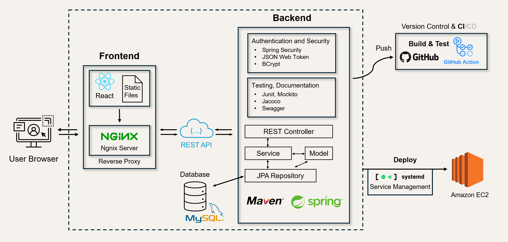

# Structure of this application


## Service Documentaion  

### Frontend  

To start the frontend service: ```sudo systemctl start nginx```

Rebuild the frontend: 
``` 
npm run build
sudo cp -r /home/ec2-user/TaskManager/tm_frontend/build/* /var/www/react-app
sudo systemctl restart nginx
```

### Backend
To start the backend service: ```sudo systemctl start backend.service```  
The service runs on port 8080.

